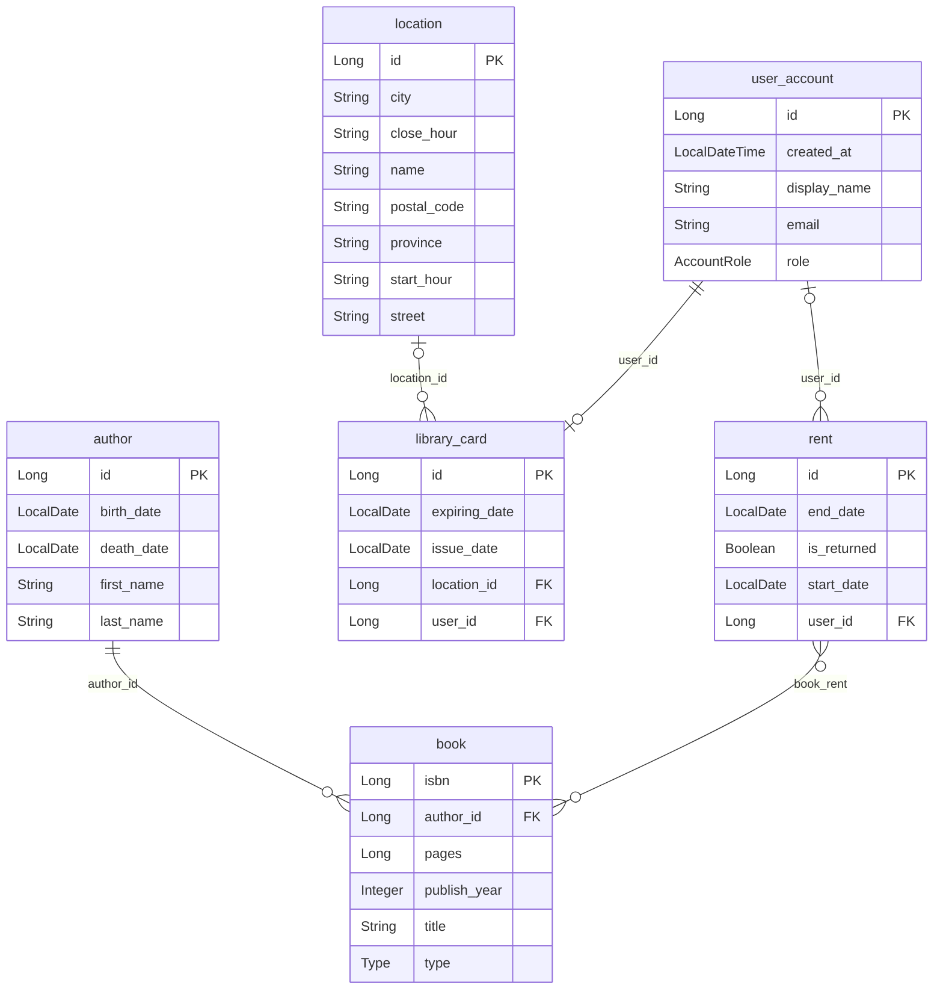

# Schemat bazy danych

Plik generują reguły projektu (panel Maven → Lifecycle → verify). Nie edytujcie go ręcznie.

Tabele: 7 (w tym tabele łączące @ManyToMany: book_rent) · kolumny: 34 · relacje: 3 × @ManyToOne, 2 × @OneToMany, 1 × @OneToOne, 2 × @ManyToMany

| Tabela | Encja | Kolumny | Klucze obce |
|---|---|---|---|
| author | Author | 5 | — |
| book | Book | 6 | author_id |
| library_card | LibraryCard | 5 | location_id, user_id |
| location | Location | 8 | — |
| rent | Rent | 5 | user_id |
| user_account | UserAccount | 5 | — |

